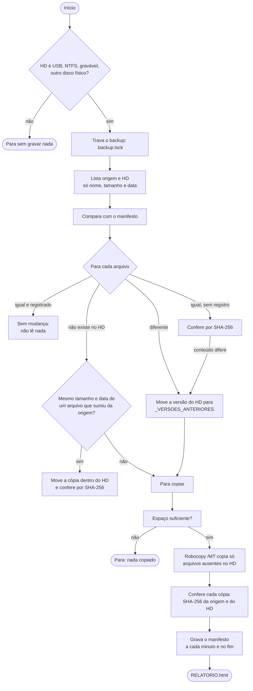

# Como funciona

Este documento descreve o motor da versão 2: o fluxo de um backup, como ele decide o que copiar, o formato do manifesto, o comando do Robocopy e as decisões técnicas — incluindo quais recomendações do relatório de pesquisa (Merkle, MinHash/LSH, Jaccard, NCD, hashes parciais, Robocopy `/MT` e `/Z`) foram adotadas e por quê.

## Arquivos do programa

| Arquivo | Papel |
|---|---|
| `Iniciar.cmd` | Menu. Confere se a instalação está completa e chama `Backup.ps1` |
| `Backup.ps1` | Linha de comando (`-Acao Backup/Simular/Verificar/Configurar/Agendar/Relatorio/Cobertura`) e códigos de saída |
| `src\Backup.Core.psm1` | Fluxo do backup e da verificação de integridade |
| `src\Nativo.cs` | Trabalho pesado em C#: listar pastas, comparar listas, SHA-256, mover arquivos, manifesto |
| `src\Config.ps1` | Leitura, validação e criação de `configuracao.txt` |
| `src\Destino.ps1` | Regras do HD de destino e localização do HD quando a letra muda |
| `src\Relatorio.ps1` | `RELATORIO.html`, `resumo.json` e resumo no console |
| `src\Cobertura.ps1` | Procurar arquivos pessoais fora das pastas do backup (opção 8) |
| `src\Agendamento.ps1`, `src\Assistente.ps1` | Agendador de Tarefas e perguntas do menu |

O C# é compilado na hora pelo próprio PowerShell (`Add-Type`) e foi escrito para o compilador do Windows PowerShell 5.1 (C# 5). Funciona igual no PowerShell 7.

## Fluxo de um backup



### A decisão para cada arquivo

| Situação no HD | Registro no manifesto | O que acontece | Lê o conteúdo? |
|---|---|---|---|
| Mesmo tamanho e mesma data | Mesmo tamanho e data | **Sem mudança** | Não |
| Mesmo tamanho e mesma data | Ausente ou diferente | **Conferido** (SHA-256 da origem e do HD); se diferir, vira “alterado” | Sim, uma vez |
| Tamanho ou data diferentes | — | **Atualizado**: a cópia antiga é movida para `_VERSOES_ANTERIORES\<data>\`, a nova é copiada e conferida | Sim |
| Não existe | Outro arquivo sumiu da origem com mesmo tamanho e data (≥ 64 KB) | **Movido** dentro do HD e conferido; se o SHA-256 não bater, a movimentação é desfeita e o arquivo é copiado | Sim |
| Não existe | — | **Copiado** e conferido | Sim |
| Só na nuvem (OneDrive) | — | Não é baixado; aviso no relatório (ou “sem mudança”, se a mesma versão já está no HD) | Não |

Arquivos apagados no computador **continuam no HD**. Registros do manifesto cujo arquivo não está mais no HD são descartados (e o arquivo será copiado de novo se ainda existir na origem).

## Por que é rápido

O que mais custava tempo na versão 1 era, para **cada arquivo**: consultar o Windows sobre a identidade dos discos (várias chamadas `Get-Disk`/`Get-Partition`), percorrer os ancestrais do caminho, iniciar um processo do Robocopy, ler o arquivo quatro vezes (SHA-256 antes, em área temporária, de novo na origem e no destino) e reabrir o CSV. A versão 2:

1. **Consulta os discos uma vez por execução** (e de novo só antes de etapas que gravam).
2. **Lista pastas com `FindFirstFileExW`** (`FIND_FIRST_EX_LARGE_FETCH`), que devolve nome, tamanho, data e atributos em lote, sem abrir arquivos (na origem, também o nome curto 8.3). Funciona com caminhos de mais de 260 caracteres (prefixo `\\?\`).
3. **Compara em memória** (dicionários em C#), sem laço lento em PowerShell.
4. **Não lê o que não mudou**: o manifesto guarda tamanho, data e SHA-256 de cada arquivo já conferido.
5. **Um Robocopy multithread por pasta de origem** (`/MT:8`, ajustável com `-Threads`).
6. **Lê cada arquivo copiado uma vez na origem e uma no HD, ao mesmo tempo** (discos diferentes trabalham em paralelo). Arquivos pequenos são conferidos em lotes de 64, quatro por vez; grandes, um por vez para não disputar o HD.
7. **SHA-256 da criptografia do Windows (CNG)**, que usa as instruções SHA da CPU quando existem. No .NET Framework, o `SHA256.Create()` padrão é a implementação gerenciada, várias vezes mais lenta.
8. **Pasta renomeada é movida dentro do HD**, sem copiar gigabytes de novo.
9. **Exclusões por nome** (`node_modules`, `__pycache__`, `.venv`, `site-packages`…) cortam a árvore inteira na listagem e no Robocopy. Em um computador real, os ambientes virtuais Python eram 94% dos arquivos de uma pasta de projetos (214 mil de 228 mil).

Resultado medido no CI (`tests\Comparar-Desempenho.ps1`, 1.504 arquivos e 112 MB): primeiro backup **11,2 s** (versão 1: 67 s), execução sem mudanças **0,1 s** (23 s), 10 arquivos alterados **0,3 s** (23 s). O primeiro backup inclui ler cada cópia do disco, sem cache (antes da 2.0.1, 6,7 s). Na versão 1 a checagem de disco por arquivo foi simulada, então o custo real dela era ainda maior.

## Por que é seguro

- **O Robocopy nunca sobrescreve**: `/XC /XN /XO` excluem arquivos “alterados”, “mais novos” e “mais antigos” — ou seja, ele só cria arquivos que **não existem** no destino. Quem decide atualizar é o programa, que antes move a versão antiga para `_VERSOES_ANTERIORES`. Mover nunca substitui um arquivo existente (`MoveFileEx` sem `REPLACE_EXISTING`).
- **Nada é apagado**: não há `/MIR`, `/PURGE` nem exclusão de arquivos, na origem ou no HD.
- **Conferência real**: o arquivo só entra no manifesto depois que o SHA-256 lido na origem e no HD coincidem, o tamanho e a data são iguais e a origem não mudou durante a leitura. A origem é aberta só com compartilhamento de leitura: ninguém grava nela enquanto é lida.
- **A cópia é lida do disco, não da memória**: logo depois de copiado, o conteúdo ainda está no cache do Windows, e lê-lo de lá confirmaria a memória, não o HD. Por isso a cópia é lida com `FILE_FLAG_NO_BUFFERING` (buffer alinhado ao setor); se o disco recusar esse modo, a leitura volta ao normal. Vale também para **Verificar integridade**.
- **Nome curto 8.3**: o Robocopy compara `/XD` e `/XF` também com o nome curto dos arquivos — `script.tmpl` tem o nome curto `SCRIPT~1.TMP`, que casa com `*.tmp`, e seria pulado. A listagem da origem lê o nome curto; o que só seria excluído por ele é copiado numa segunda passada, sem padrões de exclusão, e conferido como os demais.
- **Execuções longas não param sozinhas**: durante o backup e a verificação, o programa pede ao Windows para não suspender o computador (aparece em `powercfg /requests`; a tela ainda pode apagar) e desliga a *Edição Rápida* do console — com ela ligada, um clique dentro da janela entra no modo de seleção e pausa o programa até alguém apertar uma tecla. As duas coisas são desfeitas no fim.
- **Manifesto à prova de interrupção**: é gravado em um arquivo temporário e trocado de uma vez; a última linha tem o SHA-256 de todas as anteriores. Se o arquivo estiver truncado, editado ou corrompido, é ignorado — e os arquivos são conferidos de novo (mais lento, nunca inseguro).
- **Retomada**: o manifesto é salvo a cada minuto durante a conferência. Depois de uma queda de energia, o que já foi conferido não é lido de novo; um arquivo copiado pela metade tem tamanho ou data diferentes, vai para `_VERSOES_ANTERIORES` e é copiado de novo.
- **O HD certo**: antes de mover ou copiar, a identidade do disco é conferida de novo. Uma trava (`.backup.lock`, aberta sem compartilhamento) impede duas execuções no mesmo HD.
- **Links não são seguidos**: junções e links simbólicos (tags de reparse com o bit *name surrogate*) são ignorados e passados ao Robocopy em `/XD`/`/XF`; o caminho do destino não pode passar por links. Pastas do OneDrive (tags `CLOUD`) são percorridas normalmente.
- **Nuvem não é baixada**: arquivos com `OFFLINE`, `RECALL_ON_OPEN` ou `RECALL_ON_DATA_ACCESS` são listados como “só na nuvem” e o Robocopy recebe `/XA:O`.

## O comando do Robocopy

Para cada pasta de origem com algo a copiar:

```text
robocopy "<origem>" "<HD>\<Nome>" /E /COPY:DAT /DCOPY:DAT /XC /XN /XO /XA:O /R:2 /W:5 /MT:8 /NP /NDL /FP /UNILOG:"<log>" /XD <exclusões e links> /XF <exclusões e links>
```

| Opção | Por quê |
|---|---|
| `/E` | Inclui subpastas (inclusive vazias) |
| `/COPY:DAT /DCOPY:DAT` | Conteúdo, atributos e datas — a data igual é o que permite reconhecer “sem mudança” depois |
| `/XC /XN /XO` | Nunca sobrescreve: só copia arquivos ausentes no HD |
| `/XA:O` | Não baixa arquivos só na nuvem |
| `/R:2 /W:5` | Arquivo travado: tenta 3 vezes em ~10 s e segue; o programa registra o erro |
| `/MT:8` | Cópia com 8 threads |
| `/NP /NDL /FP /UNILOG` | Log enxuto em Unicode, com caminho completo de cada arquivo copiado |

Não são usados: `/MIR` e `/PURGE` (apagam no destino), `/Z` (modo reiniciável, bem mais lento — a retomada é feita pelo manifesto), `/B` (exige administrador), `/XJ` (pastas do OneDrive também são pontos de reparse e poderiam ser puladas; por isso os links verdadeiros são identificados pelo programa e excluídos um a um).

Se a listagem encontrou itens que o Robocopy pularia pelo nome curto 8.3, uma segunda passada copia só eles (`robocopy <pasta> <HD> <arquivo> ...`, sem `/XF`), acrescentando ao mesmo log (`/UNILOG+`).

O código de saída do Robocopy não é usado para decidir sucesso: **cada arquivo é conferido** depois. Quando há falhas, o motivo de cada arquivo é lido das linhas `ERRO` do log (por exemplo, erro 32: arquivo em uso) e aparece no relatório.

## Manifesto

`_CONTROLE\manifestos\<Nome>.tsv`, um por pasta de origem, em UTF-8, separado por tabulação:

```text
# windows-backup-audit manifesto 2
# caminho	bytes	modificado_filetime_utc	sha256	verificado_utc
Fotos\2023\praia.jpg	4821337	133401234567890000	9f86d081884c7d65…	2026-10-13T18:30:00Z
# fim 1 registros sha256=<SHA-256 de todas as linhas anteriores>
```

`modificado_filetime_utc` é a data de modificação em unidades de 100 ns desde 1601 (formato nativo do Windows). Para conferir um arquivo restaurado manualmente: `Get-FileHash arquivo` e compare com a coluna `sha256`.

## Exclusões

Mesma semântica do Robocopy: um padrão **sem barra** vale para o nome da pasta ou do arquivo em qualquer nível (`node_modules`, `*.tmp`); **com barra** compara com o caminho completo (`D:\Projetos\Grande`). Aceitam `*` e `?`. Pastas excluídas não são percorridas.

Padrões: `node_modules`, `__pycache__`, `.pytest_cache`, `.mypy_cache`, `.ruff_cache`, `.tox`, `.venv`, `site-packages`, `AppData`, `$RECYCLE.BIN`, `System Volume Information`; arquivos `~$*`, `*.tmp`, `Thumbs.db`, `*.crdownload`, `*.part`, `*.partial`. **`.git` não é excluído** (commits locais, branches e stashes não enviados são dados seus) e **`*.log` também não** (logs de experimentos podem ser dados).

## Decisões a partir do relatório de pesquisa

| Recomendação | Situação na versão 2 | Motivo |
|---|---|---|
| Filtros rápidos por pasta, tamanho e data antes do hash | **Adotado** | É o centro do incremental: tamanho + data + manifesto decidem sem ler o arquivo |
| SHA-256 para confirmar igualdade | **Adotado**, via CNG | Mais rápido que a implementação anterior; mantém compatibilidade com os SHA-256 da versão 1 |
| Trocar para SHA-512 | Não adotado | Com as instruções SHA da CPU (usadas pela CNG), o SHA-256 é mais rápido; o gargalo real é a leitura do disco |
| MD5/xxHash | Não adotado | Mais rápidos, mas o ganho é pequeno diante do disco e a confiança no resultado seria menor |
| Hash parcial (início/fim do arquivo) | Não adotado | Não prova que a cópia está correta; só serviria para detectar duplicatas, o que um backup espelhado não precisa |
| Manifesto incremental + retomada após falha | **Adotado** | Manifesto com checksum, gravação atômica e salvamento a cada minuto |
| Árvore de Merkle | Substituída por manifesto plano | O ganho prometido (não reler o que não mudou) vem do manifesto por arquivo. A árvore ajudaria a comparar dois catálogos remotos, o que aqui não acontece; um diff por caminho já localiza diferenças |
| Jaccard, MinHash/LSH, NCD | Removidos | Servem para agrupar pastas parecidas; não tornam o backup mais rápido nem mais seguro. Ficam no histórico do repositório (versão 1) |
| Robocopy `/MT` | **Adotado** | `/MT:8`, ajustável com `-Threads` |
| Robocopy `/Z` | Não adotado | Bem mais lento; a retomada é feita pelo manifesto e pela pasta de versões |
| Exclusões padrão e configuráveis | **Adotado**, exceto `.git` e `*.log` | São dados do usuário |
| Não varrer pastas do sistema | **Adotado** | Só as pastas da configuração; a pasta do Windows e discos inteiros são recusados |
| Mensagens de erro claras e verificação de arquivos essenciais | **Adotado** | `Iniciar.cmd` confere a instalação; cada erro diz o que fazer |
| PowerShell 7 | Suportado, não exigido | O paralelismo está no C# e no Robocopy; o Windows PowerShell 5.1 basta |
| Restic, Borg, Duplicati | Não integrados | Ótimas alternativas com deduplicação e criptografia, mas exigem instalação e formato próprio; este projeto prioriza um backup que se abre no Explorador |

## Limites conhecidos

- **Mudança que preserva tamanho e data** (raro; algumas ferramentas restauram a data de propósito) não é detectada pelo backup incremental. A **verificação de integridade** confere o HD contra o manifesto, não contra a origem.
- **Arquivos abertos** por outro programa falham (sem VSS/snapshot). Bancos de dados e máquinas virtuais precisam ser fechados ou exportados.
- **Permissões (ACLs), dono e criptografia EFS** não são copiados (`/COPY:DAT`). Os arquivos restaurados herdam as permissões da pasta onde forem colocados.
- O destino precisa ser **USB e NTFS**; rede (NAS) e discos internos não são aceitos nesta versão.
